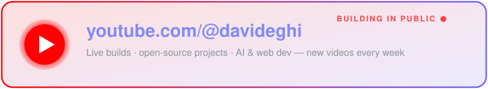

<!-- ═══════════════════ HEADER ═══════════════════ -->

  

  
  
  
  

 

<!-- ═══════════════════ ABOUT ═══════════════════ -->

## `01` About me

- 🧭 **Frontend Team Leader at [Bitrock](https://bitrock.it/)** — leading 5 developers on an enterprise booking system built from independent React micro-frontends
- 🤖 **Agent-native by default** — Claude Code, Codex and Cursor do the typing; I do the architecture and the review
- 🎥 **Building in public** on YouTube as **[@davideghi](https://www.youtube.com/@davideghi)** — live coding, agent workflows, honest model comparisons
- 🦆 **I ship my own design system**, [duck/ui](https://duckui.davideghiotto.it) — dark-first, holographic accents, distributed as a shadcn registry
- 💞️ Looking to collaborate on **open-source projects** — reach out
- ⚡ Fun fact: **dacoder** = "davide" + "coder" — or read it urban-style as *"the coder"* 😏

> [!NOTE]
> This README has a full version: a portfolio page in the same `duck/ui` style, built with React and Tailwind and living in this very repo.
> **→ [davide97g.github.io/davide97g](https://davide97g.github.io/davide97g/)**

 

<!-- ═══════════════════ YOUTUBE ═══════════════════ -->

### `02` Latest on the channel

  

 

<!-- ═══════════════════ WORK ═══════════════════ -->

## `03` What I ship

<table>
<tr>
<td width="50%" valign="top">

### 💬 [Sharp](https://sharp.davideghiotto.it/)

**The self-hosted Slack alternative.** One workspace instead of four tools — chat, docs, canvas and tasks behind a single permission model, running on a VPS I own. `Sharpy`, the built-in assistant, runs RAG over the workspace and respects every permission.

`Rust (axum)` `Postgres + pgvector` `LiveKit` `Tauri 2`

</td>
<td width="50%" valign="top">

### 🦆 [duck/ui](https://duckui.davideghiotto.it)

**My design system.** Dark-first canvas, duck-lime primary, holographic accents used sparingly, thick sticker borders. Ships as a shadcn registry, so components are copied into your project instead of imported from a package.

`Next.js` `Tailwind v4` `shadcn registry`

</td>
</tr>
<tr>
<td width="50%" valign="top">

### 🖼️ [Thumb Studio](https://thumb.davideghiotto.it/)

**Local-first YouTube thumbnail editor**, built because every generic design tool fights the 1280×720 workflow. Layer stack, in-browser background removal, parametric backgrounds, one-click PNG export. No backend.

`React 19` `TypeScript` `Vite`

</td>
<td width="50%" valign="top">

### 🔎 [Channeling](https://channeling.davideghiotto.it/)

**A personal signal archive.** Ingests the videos I watch and the notes I keep, then answers with citations back to the exact source and timestamp — walkable as a force-directed knowledge graph.

`RAG` `TypeScript` `Graph UI`

</td>
</tr>
</table>

More: **[Pulse HR](https://github.com/davide97g/pulse-hr)** (open-source, people-first HR) · **[Sonarflow](https://github.com/davide97g/sonarflow)** (AI-assisted SonarQube fixes, on npm) · **[Bitcompass](https://github.com/davide97g/bitcompass)** (modular web architecture toolkit)

 

<!-- ═══════════════════ TECH ═══════════════════ -->

## `04` Tech I work with

 

<!-- ═══════════════════ STATS ═══════════════════ -->

## `05` GitHub stats

  

  

<!-- ═══════════════════ FOOTER ═══════════════════ -->

 

<i>⭐️ From <a href="https://github.com/davide97g">davide97g</a> — building in public, one commit (and one video 🎥) at a time.</i>

  

