<!--
  Generated by scripts/profile/generate.mjs from scripts/profile/content.mjs and a
  daily snapshot of GitHub and YouTube data. Edit those, not this file.
-->

<picture><source media="(prefers-color-scheme: dark)" srcset="assets/profile/hero-dark.svg"></picture>

<a href="https://davideghiotto.it"><picture><source media="(prefers-color-scheme: dark)" srcset="assets/profile/link-site-dark.svg"></picture></a>
<a href="https://www.linkedin.com/in/davide-ghiotto/"><picture><source media="(prefers-color-scheme: dark)" srcset="assets/profile/link-linkedin-dark.svg"></picture></a>
<a href="https://www.youtube.com/@davideghi?sub_confirmation=1"><picture><source media="(prefers-color-scheme: dark)" srcset="assets/profile/link-youtube-dark.svg"></picture></a>
<a href="https://www.instagram.com/ai_quack/"><picture><source media="(prefers-color-scheme: dark)" srcset="assets/profile/link-instagram-dark.svg"></picture></a>
<a href="mailto:dacoderit@gmail.com"><picture><source media="(prefers-color-scheme: dark)" srcset="assets/profile/link-email-dark.svg"></picture></a>

 

<picture><source media="(prefers-color-scheme: dark)" srcset="assets/profile/label-activity-dark.svg"></picture>

<a href="https://github.com/davide97g?tab=repositories"><picture><source media="(prefers-color-scheme: dark)" srcset="assets/profile/activity-dark.svg"></picture></a>

 

<picture><source media="(prefers-color-scheme: dark)" srcset="assets/profile/label-work-dark.svg"></picture>

<a href="https://autocratico.it"><picture><source media="(prefers-color-scheme: dark)" srcset="assets/profile/work-autocratico-dark.svg"></picture></a>
<a href="https://duckui.davideghiotto.it"><picture><source media="(prefers-color-scheme: dark)" srcset="assets/profile/work-duckui-dark.svg"></picture></a>
 
<a href="https://thumb.davideghiotto.it"><picture><source media="(prefers-color-scheme: dark)" srcset="assets/profile/work-thumb-dark.svg"></picture></a>
<a href="https://channeling.davideghiotto.it"><picture><source media="(prefers-color-scheme: dark)" srcset="assets/profile/work-channeling-dark.svg"></picture></a>

Also: <a href="https://github.com/davide97g/sharp"><b>Sharp</b></a> (self-hosted Slack, Rust) · <a href="https://github.com/davide97g/pulse-hr"><b>Pulse HR</b></a> (people-first HR) · <a href="https://github.com/davide97g/sonarflow"><b>Sonarflow</b></a> (AI SonarQube fixes) · <a href="https://github.com/davide97g/bitcompass"><b>Bitcompass</b></a> (web architecture toolkit)

 

<picture><source media="(prefers-color-scheme: dark)" srcset="assets/profile/label-channel-dark.svg"></picture>

<a href="https://www.youtube.com/watch?v=uBSCt3gec5s"><picture><source media="(prefers-color-scheme: dark)" srcset="assets/profile/video-1-dark.svg"></picture></a>
<a href="https://www.youtube.com/watch?v=123vez064p4"><picture><source media="(prefers-color-scheme: dark)" srcset="assets/profile/video-2-dark.svg"></picture></a>
<a href="https://www.youtube.com/watch?v=sa-TQLyz2E8"><picture><source media="(prefers-color-scheme: dark)" srcset="assets/profile/video-3-dark.svg"></picture></a>

<b>More about me</b> &nbsp;stack · trajectory · how I work

 

**Now** — Frontend Team Leader at [Bitrock](https://bitrock.it/), leading 5 developers on an enterprise booking system built from independent React micro-frontends.

**How I work** — agent-native by default: Claude Code, Codex and Cursor do the typing; I do the architecture and the review. Developer experience is a product feature.

**Stack** — `TypeScript` `React` `Next.js` `Angular` `Vue` `Node.js` `Rust` `Java` `.NET` `Python` `Postgres` `Supabase` `Docker`

**Trajectory**

| | | |
|:--|:--|--:|
| Frontend Team Leader | Bitrock | 2023 — |
| Data Scientist | Infodati | 2022 — 2023 |
| R&D Full-Stack Developer | Namirial | 2021 — 2022 |
| Full-Stack Developer | Reply | 2019 — 2021 |

**Fun fact** — *dacoder* is "davide" + "coder", or, read urban-style, *the coder*.

The long version lives at **[davide97g.github.io/davide97g](https://davide97g.github.io/davide97g/)**, built from the same snapshot.

 

<picture><source media="(prefers-color-scheme: dark)" srcset="assets/profile/footer-dark.svg"></picture>
